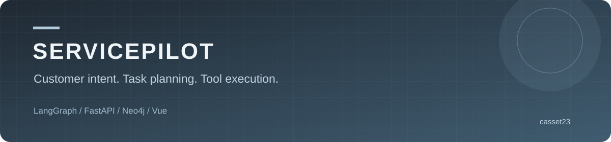
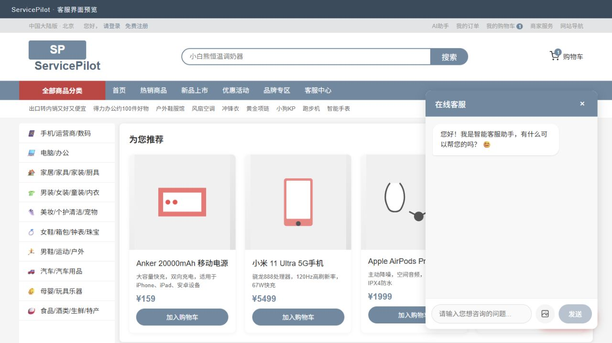
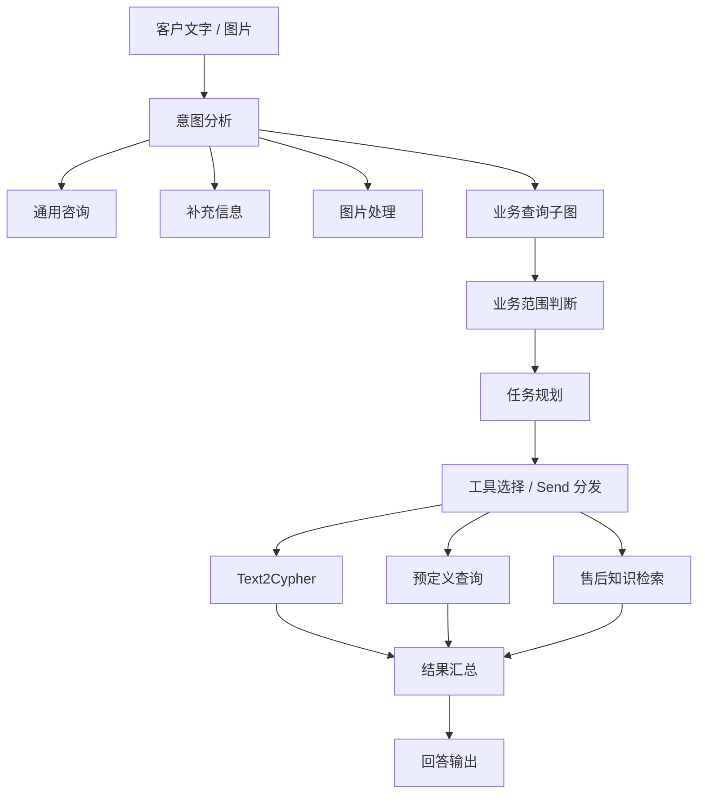
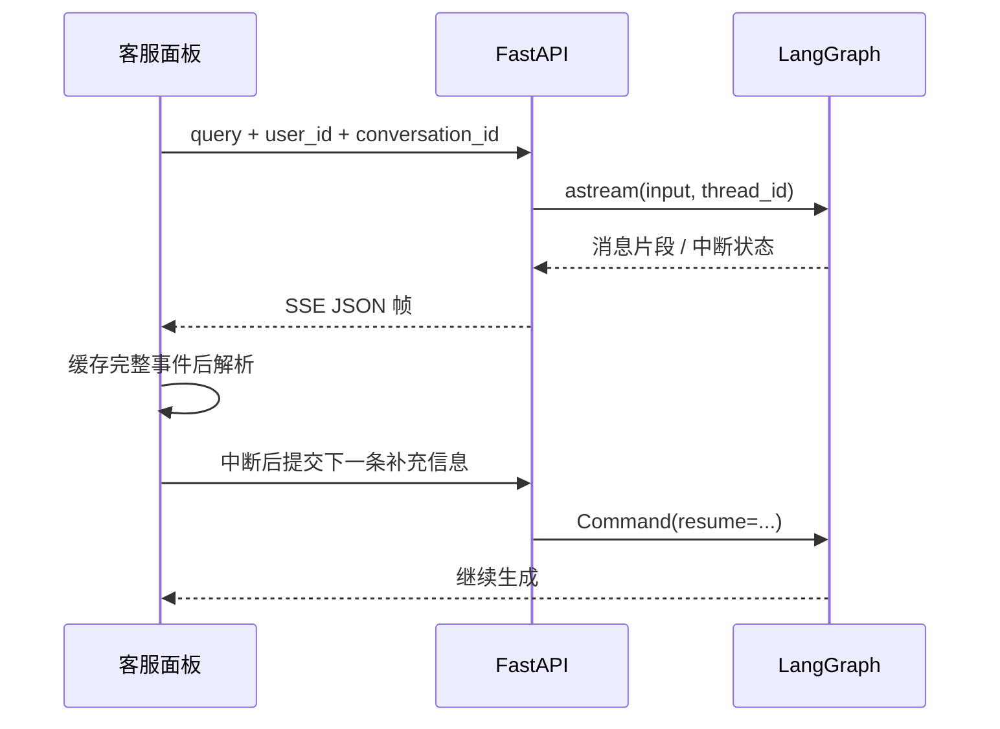

# ServicePilot Agent · 电商智能客服

以 LangGraph 状态图连接意图识别、补充询问、任务规划、工具选择与结果汇总，面向商品咨询、订单查询和售后知识问答。

[](https://github.com/casset23/servicepilot-agent/actions/workflows/ci.yml)


[客服界面](#客服界面) · [快速开始](#快速开始) · [Agent 架构](#agent-如何处理请求) · [流式协议](#流式输出与会话恢复) · [测试](#测试与构建)

## 业务场景与工程重点

电商客服面对的问题包含多种处理方式：商品介绍可以直接回答，订单问题需要查询数据，缺少订单号时需要补充信息，售后问题需要检索知识。ServicePilot 把这些分支建模为显式节点，并为复杂问题增加任务规划与工具调度子图。

- **分类路由**：通用咨询、补充询问、业务查询与图片入口，对应独立处理节点。
- **任务规划**：将复合问题拆成子任务，通过 `Send` 分发给工具选择节点。
- **工具执行**：自然语言转 Cypher、预定义查询和售后知识检索按任务选择，结果进入汇总节点。
- **会话续接**：`conversation_id` 关联 LangGraph `thread_id`，MemorySaver 管理运行上下文；中断事件通过恢复接口继续执行。
- **流式交互**：SSE 输出与客服聊天面板连接，解析器处理网络拆包、UTF-8 边界和中断元数据。

**技术栈：Python、FastAPI、LangGraph、Pydantic、Neo4j、MySQL、Redis、Vue 3、TypeScript。**

## 客服界面



客户从商品页面打开客服面板，输入问题或上传图片。`/preview` 提供只读界面预览；真实咨询通过 `/ecommerce` 页面和后端 Agent 接口处理。

## 快速开始

### 查看界面

使用 Node.js 24 LTS：

```bash
git clone https://github.com/casset23/servicepilot-agent.git
cd servicepilot-agent/frontend
npm ci
npm run dev
```

访问终端显示地址的 `/preview` 路径。预览使用内置商品和欢迎语，输入、上传和发送操作禁用，便于直接查看页面。

### 启动后端

使用独立 Python 3.12 环境，在仓库根目录执行：

```bash
cd backend
python -m venv .venv
# Windows: .venv\Scripts\activate
# macOS/Linux: source .venv/bin/activate
python -m pip install -r requirements.txt
# 将 .env.example 复制为 .env，填写模型和数据服务配置
python -m scripts.init_db
python -m uvicorn main:app --host 127.0.0.1 --port 8000
```

初始化脚本创建缺失的数据表，保留已有表。前端 Vite 将 `/api` 请求代理至本地 8000 端口。

| 配置 | 用途 |
| --- | --- |
| `DEEPSEEK_*`、`OLLAMA_*` | 对话、路由、规划等模型调用 |
| `AGENT_SERVICE` | 选择 `deepseek` 或 `ollama` |
| `VISION_*` | 图片问题处理 |
| `DB_*` | MySQL 用户与应用会话数据 |
| `REDIS_*` | 缓存服务 |
| `NEO4J_*` | 商品、订单、客户等业务图数据 |
| `GRAPHRAG_PROJECT_DIR` | 售后知识索引工作区 |
| `SECRET_KEY` | 登录签名密钥，配置为本地随机值 |

图查询需要准备匹配业务 Schema 的图数据；售后检索需要配置知识索引工作区。节点定义与查询参数见 `backend/app/lg_agent/kg_sub_graph/`。

## Agent 如何处理请求



| 层次 | 责任 | 代码入口 |
| --- | --- | --- |
| API | 接收表单、分配线程、组织 SSE、处理恢复请求 | [backend/main.py](backend/main.py) |
| 主状态图 | 分类与节点编排、运行上下文 | [lg_builder.py](backend/app/lg_agent/lg_builder.py) |
| 路由规则 | 分类到节点的映射、图片优先级、非法分类拒绝 | [routing.py](backend/app/lg_agent/routing.py) |
| 客服子图 | 范围判断、计划拆解、工具执行与汇总 | [multi_tool.py](backend/app/lg_agent/kg_sub_graph/agentic_rag_agents/workflows/multi_agent/multi_tool.py) |
| 工具 Schema | 任务字段、预定义查询参数、知识查询输入 | [kg_tools_list.py](backend/app/lg_agent/kg_sub_graph/kg_tools_list.py) |
| 前端 | 客服面板、图片上传、流式消息、恢复请求 | [CustomerPortal.vue](frontend/src/views/CustomerPortal.vue) |

### 状态与数据的组织

主图将消息、路由结果和执行信息组织为状态，业务子图通过问题与结果衔接。工具选择通过 Pydantic Schema 解析模型返回的调用参数，汇总节点收集各子任务结果再生成回答。

Agent 的运行上下文由 MemorySaver 按线程保存，应用用户与会话信息由 MySQL 数据层管理。两类状态分别服务于执行续接和应用记录。

## 流式输出与会话恢复



服务端以 JSON 字符串传递文本，以 JSON 对象传递中断信息：

```text
data: "正在查询订单信息"

data: {"interruption":true,"conversation_id":"customer-session"}

data: [DONE]
```

[sse.ts](frontend/src/utils/sse.ts) 按完整事件分隔解析，保留跨网络块的 UTF-8 字节与 JSON 内容；支持 CRLF、注释帧、结束标记和 EOF 收尾。客服面板将文本追加到当前消息，收到中断元数据后，通过恢复接口提交补充信息。

| 接口 | 输入与用途 |
| --- | --- |
| `GET /health` | 存活检查 |
| `POST /api/langgraph/query` | FormData：`query`、`user_id`、可选 `conversation_id` 与 `image` |
| `POST /api/langgraph/resume` | JSON：`query`、`user_id`、`conversation_id` |
| `POST /api/upload/image` | 图片上传 |
| `/api/conversations` 及子路径 | 应用会话创建、查询、重命名与删除 |

完整接口参数可通过后端 `/docs` 查看。

## 测试与构建

在仓库根目录执行：

```bash
python -m pip install -r requirements-check.txt
python -m unittest discover -s tests -v
node --test tests/sse.test.mjs
python -m compileall -q backend
```

前端目录执行：

```bash
npm run type-check
npm run build
```

| 测试 | 覆盖内容 |
| --- | --- |
| Python 路由测试 | 分类映射、运行配置中的图片优先级、空配置、未知分类 |
| 状态图续接 | 实际 LangGraph 中断、客户回复恢复、无需补问时直接结束 |
| 源码引用检查 | 应用内部模块完整性、主图路由接线与接口入口 |
| SSE 测试 | 单字节拆包、中文和转义字符、CRLF、多事件、中断对象、DONE、EOF、异常 JSON |
| 前端检查 | Vue 类型与生产构建 |

CI 执行路由、状态图续接、SSE、源码引用和前端检查，日志见 [GitHub Actions](https://github.com/casset23/servicepilot-agent/actions)。

## 目录导览

```text
backend/
  main.py                    # HTTP 与流式接口
  app/core/                  # 配置、数据库、缓存、日志
  app/lg_agent/              # 主图、状态、路由与提示词
    kg_sub_graph/            # 客服规划与工具子图
  app/models/                # 用户、会话、消息
  app/services/              # 模型与应用服务
frontend/
  src/views/CustomerPortal.vue
  src/views/AgentWorkspace.vue
  src/utils/sse.ts
tests/                       # 路由与协议回归
```

工作流组件的第三方许可见 [THIRD_PARTY_NOTICES.md](THIRD_PARTY_NOTICES.md)。
